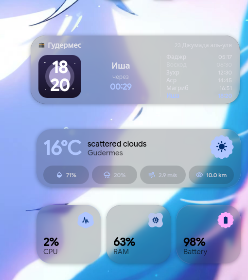

# 🕋 Hyprland Prayer Widget

Красивый интерактивный виджет времени намаза в стиле iOS / Android для **Hyprland** (Wayland) на базе **Quickshell**.

Поддерживает как работу в качестве автономного виджета для любого окружения Hyprland, так и глубокую интеграцию в конфигурации **end-4** (`illogical-impulse`).



---

## ✨ Особенности

- ⏱️ **Точное расписание и живой таймер:**
  - Автоматический расчёт по координатам солнца (Aladhan API) + локальный оффлайн-кэш (работает без интернета).
  - Таймер отсчёта до следующего намаза в реальном времени.
- ☀️ / 🌙 **Динамическая графика:**
  - **Ночь (Иша, Фаджр):** глубокий космос, светящаяся луна и мерцающие звёзды.
  - **День (Зухр, Аср):** ясное небо и сияющее солнце.
  - **Закат/Рассвет (Магриб, Восход):** сумеречное солнце и тёплые багровые градиенты.
- 🕌 **Дата по Хиджре и праздники:**
  - Точный исламский календарь по Хиджре.
  - Автоматическая разметка священных дней: в пятницу загорается бейдж **«Джума»**, в праздники — **«Ураза-Байрам»**, **«Курбан-Байрам»**, **«Рамадан»**, **«Ляйлят уль-Кадр»** и др.
- 💎 **Стеклянный неоморфизм (Glassmorphism):**
  - Аппаратное размытие обоев (`FastBlurred`) и автоматическая адаптация под системную цветовую палитру Material You.
- 🖐️ **Свободное перемещение мышкой (Drag & Drop):**
  - Виджет можно просто зажать левой кнопкой мыши и перетащить в любую точку экрана.

---

## 🚀 Установка

### 1. Убедитесь, что установлен Quickshell:
```bash
# На Arch Linux:
yay -S quickshell-git
```

### 2. Клонируйте репозиторий:
```bash
git clone https://github.com/KARAPUZ1226/hyprland-prayer-widget.git
cd hyprland-prayer-widget
```

### 3. Запустите скрипт установки:
```bash
./install.sh
```
*Скрипт сам определит, используете ли вы illogical-impulse (end-4), или установит автономную версию.*

---

## ⚙️ Настройки (`config.json` / `prayer_config.json`)

```json
{
  "city": "Гудермес",
  "latitude": 43.3506,
  "longitude": 46.0953,
  "method": 14,
  "hijri_offset": 1,
  "offsets": {
    "Fajr": 11,
    "Sunrise": -2,
    "Dhuhr": 51,
    "Asr": 22,
    "Maghrib": 5,
    "Isha": 14
  }
}
```
- **`latitude` / `longitude`**: географические координаты вашего города.
- **`method`**: метод вычисления (14 — Духовное управление мусульман РФ, 3 — Всемирная исламская лига и т.д.).
- **`offsets`**: ручная корректировка в минутах для каждого намаза под расписание местной мечети.
- **`hijri_offset`**: поправка дня по Хиджре (+1 или 0 в зависимости от видения луны).

---

## 📄 Лицензия

MIT License
